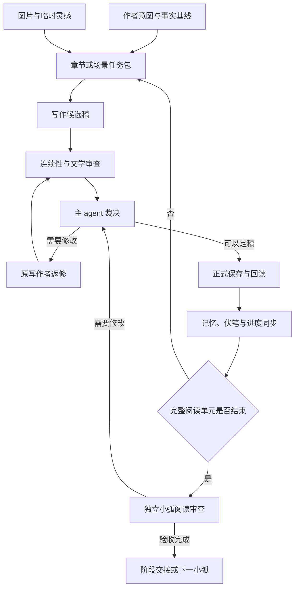

# Novel Engineering Skill · 小说工程工作流

**让 AI 协助小说创作时，既能接住作者的想法，也能管理长篇写作中的事实、版本、审查和接续。**

Novel Engineering 是一个作者主导、AI 辅助执行的小说工程化创作 Skill。它把章节写作、多 agent 协作、连续性审查、小弧阅读验收、素材管理和工作交接组织成一套可裁剪的流程。执行指令采用英文，小说、报告和交流语言遵循作者要求；本 README 使用中文介绍。

它适用于已有小说的接续与修订，也可用于新项目。科幻、奇幻、悬疑、言情、现实主义等题材可以选择不同的检查重点；短篇和简单修改不必承担长篇工程的全部步骤。

**作者决定故事方向，AI 负责在授权范围内完成创作、核查与维护。**

## 项目定位与使用前提

**本项目帮助作者把创作想法落实为小说，并维护持续写作与修订的过程；它不是输入一个主题就能无人参与地自动产出优质长篇小说的系统。**

核心用途是将作者的剧情构思、人物关系、世界观、场景和情绪意图转化为正文，再通过任务组织、审查返修和状态维护支持作品逐步完善。AI 可以在授权范围内发挥创造性，作者保留核心创作方向与最终作品的决定权。

### 1. 作者主导方向，AI 在授权范围内创作

作者决定主要剧情、人物命运、关键转折、世界规则和结局等核心事项，也可以明确委托 AI 提出或发展方案。已经确认的选择不应被 AI 擅自改变；尚未决定的内容应保持候选身份，不能冒充作者定案。

AI 可以承担具体写作、人物对话、动作反应、环境描写、场景调度、局部逻辑补足、审查返修和项目维护。普通实现应在授权范围内自主推进，不要求作者逐句审批；涉及核心方向的新决定则需要作者裁决。

例如，作者确定“两个人因隐瞒产生误会，其中一人最终离开”，AI 可以设计对话、动作、环境和情绪递进，也可以提出更有表现力的细节建议。但不能仅因偏好另一个结果，就把已确定的离开改成团圆。

**自动执行已授权任务，与自行决定作品方向，是两件不同的事。** 本 Skill 支持前者，同时明确后者的授权边界。

### 2. 适合有创作方向、愿意参与关键决定的作者

你可以提供完整大纲，也可以从人物关系、几个场景、剧情片段或预期的情绪表达开始。不要求动笔前规划整部作品；AI 可以协助梳理缺口、提出备选方案，随着创作逐步完善。

使用者需要表达创作意图、确认关键选择，并判断成稿是否符合自己的审美。若期待给出一个主题后完全放手、无需判断便得到最终作品，本项目的工作方式可能不符合这一期待。

### 3. 工作流帮助发挥模型能力，不替代模型能力

安装本 Skill 不会训练模型或改变模型权重，也不会直接赋予模型超出其已有能力的文学水平。它通过上下文组织、任务分解、审查返修和状态维护，帮助模型更有条理地运用已有能力。

同一模型在充分掌握作者意图、人物状态和相关设定，并经过有效复核后，可能比直接生成更好地落实细节与连续性；这不等于每次都能提高文学质量。最终结果仍受模型能力、作者提供的信息、任务复杂度、上下文条件和实际执行效果共同影响。

**工程化流程旨在减少部分遗漏、冲突和管理风险，不保证优秀文学作品，也不替代作者的审美判断。** 本项目目前没有量化证明质量提升或错误减少的幅度。

### 4. 完整协作可能带来显著更高的成本

与一次性长文本生成相比，多 agent 写作、多轮审查返修、连续性核查、版本维护和小弧阅读可能产生更多模型调用、Token 消耗、执行时间及工具调用开销。启用完整流程时，成本可能显著增加，不能笼统承诺只是“略高”。

实际开销取决于任务规模、所用模型、上下文长度、返修轮次、宿主能力和启用的流程。并行执行有时可以缩短等待，但不等于降低总消耗。

流程应按任务裁剪：单处笔误无需整套多 agent 审查，短篇也不必搭建长篇资料体系。本项目优先考虑创作的可控性、连续性和可维护性，不以最低生成成本或最快输出速度为主要目标，也不承诺总体上一定更划算。

### 5. Skill 提供执行规范，宿主提供实际能力

本仓库交付供 Agent 遵循的指令、参考流程和记录模板，不自带独立运行的小说管理服务或完整自动化系统。

实际执行依赖宿主提供的文件访问、模型调用、子 agent 协作和可选 MCP 等能力。没有相应工具时，需要采用文件工作方式、串行复核，或明确保留未完成项；不能仅因文档规定了一个步骤，就宣称已经自动实现。

作者持续参与关键创作决策和最终判断；AI 则在约定范围内完成具体创作、完善与维护。后文的能力介绍均以这一分工和宿主实际能力为前提。

## AI小说常见问题

小说写作的困难，并不只在于生成下一段文字。

随着章节增多、设定调整和参与者增加，常见问题包括：

- 人物知道了尚未获得的信息。
- 未来计划被当成已经发生的事实。
- 正文修改了，摘要和伏笔记录仍停留在旧版本。
- 多个 agent 提出的建议彼此冲突，返修后又引入新问题。
- 每章单独看都能通过检查，连起来却重复、松散或缺少情绪积累。
- 场景图片和临时灵感积累很多，写作时却没有被参考。
- 换聊天或换执行者后，重复工作、遗漏任务，甚至覆盖已经提交的内容。
- 一句“已完成”掩盖了尚未进行的文学审查或资料同步。

本 Skill 为这些问题提供明确的工作步骤、责任分工和证据记录。它帮助创作者保持项目可理解、可核查、可接续，同时为文学判断留下空间。

## 核心能力

### 1. 版本化记忆：知道记录对应哪一版正文

章节摘要容易保存，难的是确保它仍然正确。

本 Skill 要求章记忆关联正文版本，并区分：

- 已发生的客观事实；
- 角色知道或相信的内容；
- 尚未证实的猜测；
- 未来计划与作者层信息。

例如，某章返修后，人物不再获得一封信。后续摘要若仍记着“人物已读信”，就可能让下一章继续使用已经失效的知识。

版本化记忆的处理方式是：

1. 记录改动前后的正文版本。
2. 查找受影响的记忆、人物认知和后续线索。
3. 将相关旧结论标为待复核。
4. 根据实际正文重新确认，而不是直接复制旧摘要。

**产物：**绑定版本的章记忆、影响范围和复核记录。

这是一套工作约定。若项目没有自动依赖追踪工具，影响范围仍需要执行者核查，不能宣称已经自动解决。

### 2. 多 agent 协作：分开写作、审查和最终决定

多 agent 的价值在于职责清楚、检查视角独立、成果能够合并。

| 职务 | 主要职责 | 权限边界 |
|---|---|---|
| 主 agent | 制定任务包、处理争议、审阅定稿、维护进度 | 唯一正式正文和共享事实资料写入者 |
| 写作 subagent | 完成草稿、返修及逐项回应 | 只修改分配的候选稿 |
| 连续性审查 | 核对时间、空间、人物状态、能力、认知和因果 | 提供证据，不直接改正式正文 |
| 文学审查 | 检查表达、人物声音、节奏和场景有效性 | 区分规则问题与审美建议 |
| 伏笔与资料 | 核对线索状态、素材使用和记忆更新 | 不把规划登记成正文事实 |
| 小弧阅读审查 | 检查跨章阅读体验 | 原则上不参与被审查段落的写作 |

这些是职务，不要求全部同时运行。并发数量取决于环境和任务规模；简单查询或单处笔误可以直接处理。

通常的返修路径是：

**写作者交稿 → 审查者提出意见 → 主 agent 裁决 → 原写作者返修 → 审查者复核 → 主 agent 定稿。**

每项意见需要说明位置、版本、证据、影响和建议。意见不一致时，依据作者决定与正文事实处理，不通过多数投票改变故事。

**产物：**章节任务包、候选稿、审查意见、修订单和最终处置记录。

### 3. 小弧阅读验收：检查整段是否值得读下去

连续性正确，不等于阅读体验成立。

一个小弧可能没有明显矛盾，却存在以下问题：

- 连续几章只是换地点、听说明。
- 配角只负责提供线索，没有自己的诉求。
- 主角反复表达同一个愿望，却没有新的选择或理解。
- 场景描写丰富，但不影响人物行动。
- 情绪主要由旁白解释，没有通过经历积累。

因此，本 Skill 在完整短篇、小弧完成或多章结构返修之后，增加独立阅读审查。

审查分为两个阶段：

**第一阶段：先读正文。**  
审查者只获得必要的读者已知背景，按作品呈现顺序阅读，记录投入、疑惑、疲倦、期待和情绪变化。此时不提前提供目标卡、未来答案或写作者解释。

**第二阶段：再看创作目标。**  
保存初读记录后，再对照目标卡与适用约束，判断创作意图是否真正出现在正文里。

重点包括：

| 维度 | 核心问题 |
|---|---|
| 阅读动力 | 读者为什么继续？何处开始失去关注？ |
| 人物主动性 | 人物是否作出选择？配角是否有独立诉求？ |
| 情绪积累 | 情绪是否由经历形成，而非反复说明？ |
| 场景作用 | 环境和世界设定是否参与行动与感受？ |
| 节奏与重复 | 哪些章节承担了相同功能？ |
| 回应与余味 | 本段回应了什么，又留下什么值得关注的问题？ |

安静、留白、非线性叙事或开放结尾不自动构成缺陷。判断必须服务于作品的目标。

**产物：**初读轨迹、目标对照报告、具体修订建议及复核结果。

独立 AI 审查提供一种阅读视角，不能代表所有真实读者，也不能代替作者的最终判断。

### 4. 素材接入：让图片与临时灵感进入实际写作

作者可以直接放入图片、短语、零散想法或尚未展开的主题，不必先整理成完整设定。

流程在准备创作任务时检查实际新增内容，并记录：

- 作者原话与场景定位；
- AI 的视觉解读或实现建议；
- 本章适用的素材；
- 相关但暂缓的内容及理由；
- 正式正文中的实际使用位置。

素材管理区分三个维度：

| 维度 | 示例 |
|---|---|
| 场景存在状态 | 未写、已出现、待核 |
| 素材处理状态 | 待整理、待安排、已安排、已采用、持续参考 |
| 细节采用状态 | 未核对、局部采用、已核对 |

例如，一张已经出场的城市图片可以作为视觉补充，无须重新安排城市首次出现。图片中的飞行器，也不会自动成为世界里已经存在的交通工具。

**产物：**素材索引、任务包引用和正文使用记录。

素材检查由工作流程触发；没有监听工具时，不声称后台自动发现文件变化。

### 5. 主 agent 接续：换上下文也能找到下一步

长任务不能依赖一个聊天永久记住全部内容。

本 Skill 要求在派发、交稿、裁决、提交等节点保存检查点，记录：

- 当前目标与作者新决定；
- 使用的计划和正文版本；
- 各子任务的责任人、状态与产物路径；
- 尚未解决的审查意见；
- 正文是否保存、回读和同步；
- 下一项具体动作。

恢复工作时，先核对实际文件和可访问的任务状态，再继续最小未完成单元。

如果前任声称已经提交，但缺少回读证据，新执行者应先确认实际正文，而不是再次覆盖。换新聊天时，也不假设旧 subagent 会自动迁移或仍可控制。

**产物：**短接续入口、任务账本和提交证据。

### 6. 分项验收：让“完成”有明确含义

某章可以已经保存，但文学审查仍未完成；记忆可以已经确认，但整个小弧尚未经过独立阅读。

本 Skill 将这些状态分开：

| 项目 | 需要的证据 |
|---|---|
| 正文保存 | 实际版本与回读结果 |
| 连续性审查 | 对应版本的核查记录 |
| 文学审查 | 意见及处置理由 |
| 章记忆确认 | 与正文版本一致的记忆记录 |
| 提示处置 | 已修改、保留、误报或待决定的逐项结论 |
| 小弧阅读验收 | 阅读报告与必要返修复核 |

正文变化后，受影响的旧结论需要重新核对。扫描数量降低，也不能直接解释为小说质量提高。

### 7. 灵活的文风审查：提供线索，不强制统一表达

本 Skill 不设置跨作品通用的禁词表、固定句式上限、章长或“每章必须反转”的要求。

文风审查可以关注：

- 关联词和句首的重复；
- 对比、因果、递进等句式的集中使用；
- 整句重复与同义反复；
- 多段文字承担相同功能；
- 解释过量、人物声音趋同。

这些现象需要结合文本长度、局部密度和写作意图判断。人物口吻、排比、复沓和刻意重复都可能有价值，不能只为降低计数而换同义词。

作者明确的剧情边界应在出稿时遵守，机械检查作为保底。

## 完整工作流程



长任务在关键节点持续保存检查点，不等到上下文接近上限才整理。

## 一个使用案例

假设你正在创作一部悬疑小说，准备写第十二章，同时提供了一张已经出场的车站参考图。

1. **主 agent 核对事实。**  
   确认上一章结束状态、人物掌握的线索，以及尚未向读者揭示的信息。

2. **准备任务包。**  
   明确本章的行动目标、允许揭示的信息和车站图片中适合参考的特点。图片里新增的设施只作为候选，不直接确立为设定。

3. **写作与审查。**  
   写作者完成候选稿。连续性审查发现人物使用了尚未拿到的证据；文学审查发现几段描述重复了相同的紧张感。

4. **裁决与返修。**  
   主 agent 合并意见，交原写作者修订。返修后分别复核事实和阅读效果。

5. **保存与同步。**  
   正文保存并回读后，更新人物认知、线索状态和素材使用记录。

6. **小弧验收。**  
   本段故事完成时，独立阅读者先读正文，再看包含谜底的目标卡，检查悬念与回应是否成立。

如果中途换聊天，新执行者从检查点恢复，不需要作者重新解释整部小说。

## 按任务规模使用

| 任务 | 建议采用的流程 |
|---|---|
| 单处笔误 | 局部读取、版本核对、修改回读 |
| 一个独立短篇 | 简短目标、成稿、适用审查与完整阅读 |
| 连载长篇 | 章节任务包、版本记忆、资料同步、小弧验收 |
| 多人或多 agent 协作 | 增加责任分工、产物隔离与统一提交 |
| 接手已有项目 | 先核对现状和未完成项，不立即重建全部工程 |
| 无 MCP 环境 | 使用文件、版本记录和回读 |
| 无 subagent 环境 | 串行复核，并注明未完成独立审查 |

## 安装与开始

将仓库中的 `skills/novel-engineering/` 完整目录放入宿主支持的 skill 目录，并确认其可被发现。

也可以让支持读取文件的助手直接读取 [SKILL.md](skills/novel-engineering/SKILL.md)，再按任务加载相关参考文件，无需一次读取整个仓库。

示例：

```text
使用 $novel-engineering 接手这部小说。
先核对现有目录、作者决定和当前进度，
继续未完成的工作，不要重做全部章节。
```

```text
使用 $novel-engineering 写下一章。
先准备任务包，检查相关素材，
写后核对连续性和文学效果。
```

```text
使用 $novel-engineering 审查这个完整小弧。
安排未参与写作的阅读 subagent，
先保存初读感受，再对照创作目标。
```

## 仓库内容

```text
skills/novel-engineering/
  SKILL.md                     入口与任务路由
  agents/openai.yaml           可选界面元数据
  references/
    project.md                项目基线、题材适配与状态
    collaboration.md          分工、审查与返修
    arc-reading.md            完整阅读单元验收
    materials.md              图片与临时灵感
    continuation.md           版本记忆与接续
    tools.md                  文件与 MCP 适配
  assets/
    work-records.md            可选任务记录模板

validation/                    虚构场景验证记录
```

README 解释设计与使用方式；具体执行规则维护在 Skill 及参考文件中。

## 当前能力与限制

当前版本提供的是**可执行的工作流说明、责任划分和记录模板**。

它不自带：

- MCP 服务端或小说数据库；
- 自动文件监听；
- 自动依赖追踪与失效传播程序；
- 常驻多 agent 调度器；
- 自动新建聊天和迁移执行者的系统。

有相应工具时可以适配；没有时，需要执行者按文件流程落实。不能把流程规定误称为已经实现的自动化。

目前已完成结构检查及四个虚构场景的独立流程推演，涉及简单修改、提交结果不明、已有场景图片和悬疑独立阅读。**这些验证不证明所有题材的文学效果，也没有量化证明它能减少多少遗忘或返工。**

后续改进应依据实际项目中的遗漏、返修和阅读反馈，不为追求流程完整而不断增加负担。

## 分享与许可

仓库仅包含通用工作方法、模板和虚构验证案例，不包含原小说正文、人物设定、场景图片或私有项目路径。

当前尚未指定开源许可证。公开可见与开放授权是不同事项，具体许可由维护者另行决定。
